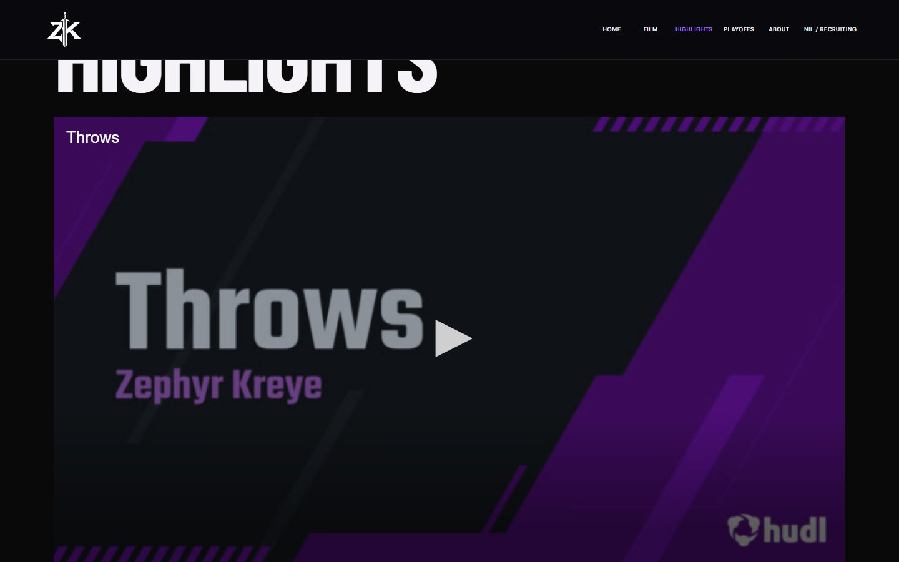

# Dedicated Highlights page — QA

Hudl now lives at /highlights/ under a new HIGHLIGHTS navigation item. FILM retains the cinematic movie. Homepage ON THE FIELD returns to its approved photographic composition and field motion; it contains no Hudl iframe and makes no Hudl requests. Cinematic imagery, timing, color-photo addition, logo refinements and removed WATCH FILM buttons are unchanged.

Both header variants use the same six-destination navigation tuple. The new route has its own canonical/title and sitemap entry. Hudl retains the exact supplied URL, descriptive title, lazy loading, no autoplay, fullscreen/PiP permissions and strict-origin referrer policy. CSS preserves16:9 and caps the player to the usable viewport height on short desktop/landscape. A long page can scroll; the full player remains usable below the fixed header.

## Validation
Build, lint, TypeScript and62unit tests pass. Canonical/sitemap/accessible iframe/homepage-separation export checks pass. Initial full browser run:192pass7existingconditional skips5fail. Four were test locator errors (homepage #site-nav retained after navigating to route #route-nav), repaired without weakening assertions. One WebKit direct-route loop emitted an RSC access-control error that did not reproduce in scoped validation. All28affected checks passed, including that route loop. The final full-run result is recorded below when complete; earlier failures retained.

Independent desktop Chromium and iPhone-sized WebKit verification confirmed menu/navigation/active-tab state, usable16:9 player, restored actual field photos and no horizontal overflow. Real Hudl starts paused/time0; afterclick it advances in both engines. Chromium fullscreen confirmed parent IFRAME. Homepage generated zeroHudl requests in both journeys and no pageerrors. Physical iPhone fullscreen/PiP and deviceperformance remain unverified.

The previously observed upstream JW-player ARIA issue remains vendor-owned. Current audits can return no violations but incomplete/manual-review results for that markup, captions or contrast; this is not proof Hudl has resolved accessibility. No axe rule or iframe exclusion was added to hide it. See independent review and actual logs.

## Evidence and delivery
Evidence, source fingerprint and independent review: ../.agent/evidence/highlights-page/. Desktop screenshot is player-focused after scrolling; portrait screenshot shows the route heading and player. DEV preview update is owner-authorized. Production/main remain unchanged and PR11 remains unmerged.

Final full-browser rerun:197passed,7existingconditional skips,0failures (e2e-final.log), exit0. This includes the repaired navigation assertion and the previously transient WebKit route loop. All62unit tests and build/lint/type/export indexing checks pass. Independent review cleared owner-authorizedDEVpreview; vendor manual-review limitations remain.

DEV delivery verified: https://cinematic-opening-dev.zk17-review.pages.dev/highlights/ ; immutable https://00b39a31.zk17-review.pages.dev at source2ec0a703. Remote real playback, active navigation and homepage separation passed desktop/iPhone-sizedWebKit; desktop fullscreen passed. Preview noindex; production unchanged; PR11unmerged. See live-remote.json and deploy-receipt.json.
