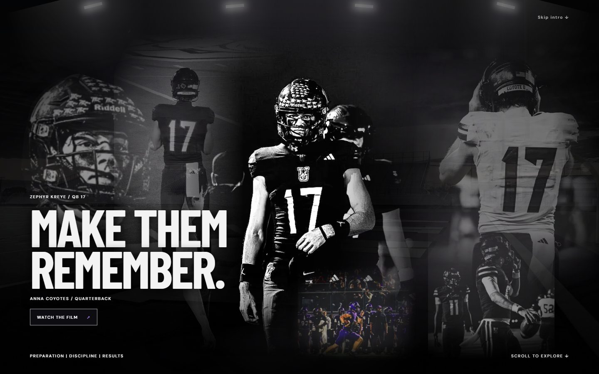
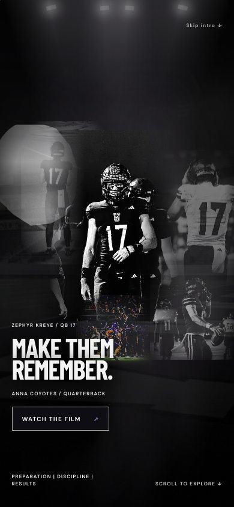

# Hudl and final cinematic edits — review QA

Owner-requested scope on the existing PR11 feature branch:
- Official Hudl highlights in ON THE FIELD, replacing that section's previous media. Responsive16:9, lazy iframe, descriptive title, fullscreen/PiP permissions, no autoplay and no site overlays/cropping.
- Remove header WATCH FILM button/play icon/handler/styles. Retain hero WATCH THE FILM and FILM navigation.
- Remove the large later montage monogram, preserving the opening logo.
- Add supplied game action photo in color; crisp foreground with a subtly blurred background-edge duplicate. Existing montage photos and scroll distance retained.
- Small FilmRoom logo becomes white on transparent background without grey glow or black filter, reusing the exact canonical mark.

## Media and visual fidelity
Canonical512px logo decoded to217923 fully transparent pixels and44221 white nontransparent pixels, no other RGB colors. No generative redraw is needed. New action original/provenance accompanies its optimized derivative; owner supplied it and expressly asked to retain color. Existing media eligibility gates remain in place. No dependencies added.

## Hudl live evidence
The official endpoint returns200, permits framing via frame-ancestors *, and sends no X-Frame-Options restriction. Actual embedded Hudl playback starts paused at0, then advances after a user click in desktop Chromium and iPhone-sized WebKit. Independent Chromium test entered fullscreen via Hudl's native control: parent fullscreenElement was the iframe. Actual player kept the same document and advancing playback through resize/reduced-motion/asset-refresh after pin repair. No physical iPhone, native iOS fullscreen/PiP session or hardware performance claim is made.

## Pinning repair
A live iframe in the existing generated On Field pin spacer was repeatedly reparented during global refresh. This reloaded the player and intermittently threw insertBefore. A stable pre-rendered native field spacer preserves the same iframe browsing context and the existing field pin. Existing timing is retained via a terminal timeline hold. Independent repaired probes:8/8startup+Skip runs with no errors; actual Hudl playback survives refreshes and breakpoint/motion changes. Deterministic regression fixtures check geometry/context only; they are not playback evidence. See .agent/evidence/hudl-integration/pin-repair.md.

## Upstream accessibility finding
Full-page axe can report serious aria-prohibited-attr inside Hudl's cross-origin JW player: div.jwplayer has aria-label="Video Player" without a valid role (target iframe → .jwplayer). The site's iframe has the requested descriptive title. We cannot change Hudl's document. The existing axe check is retained; its result is reported rather than suppressed. Do not describe this as a clean full-page accessibility audit.

## Validation and delivery
Final build/lint/type/unit/browser results and independent review will be recorded below after the integrated candidate is frozen. All earlier failed/interrupted runs remain diagnostic evidence. New edits are review-only: no merge or deployment. The development URL continues serving the earlier cinematic until another deployment is requested.

## Final verification

- Build, lint and TypeScript pass;62unit tests pass.
- Full integrated browser suite before the final edge-mask-only adjustment:188passed,7existingconditional skips,1failure. The sole failure is the retained upstream Hudl JW-player ARIA finding described above.
- After the final CSS edge refinement:40affected browser checks pass across desktop/mobile Chromium, iPhone WebKit and reduced motion. Final build/lint pass. This distinction is intentional; no all-green full-suite claim.
- Final desktop/portrait/landscape screenshots are in ../.agent/evidence/hudl-integration/final-screenshots/. No horizontal overflow observed. Independent real-player runs had no pageerrors and verified playback/context retention/fullscreen. Broad desktop captures also logged third-party ad DNS/report-onlyCSP messages; raw ZH entries lacked origin and remain unattributed. Mobile/landscape captures logged none. These are not silently counted as a clean console audit.
- Original running photo and added color photo have distinct positions/beat timings; opening logo stays, later large mark is absent. Small logo uses existing white alpha PNG without backdrop/filter. The supplied action original and SHA-256 are retained; preview manifest/distribution gates cover its derivative.

Independent Astra review accepted product commit57e2b812da0939a5509562b5d86d1ff6c5681be6 for review-only PR delivery. Hudl upstreamARIA P2 remains documented; no merge/deploy authorization. Exactsourcehashes and evidence are in final-review.md.
