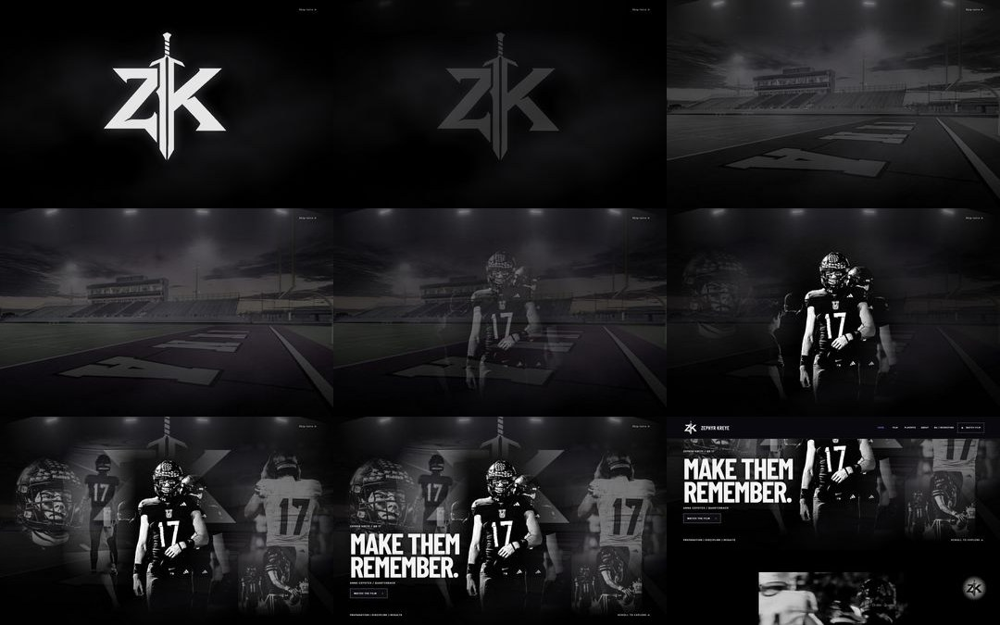
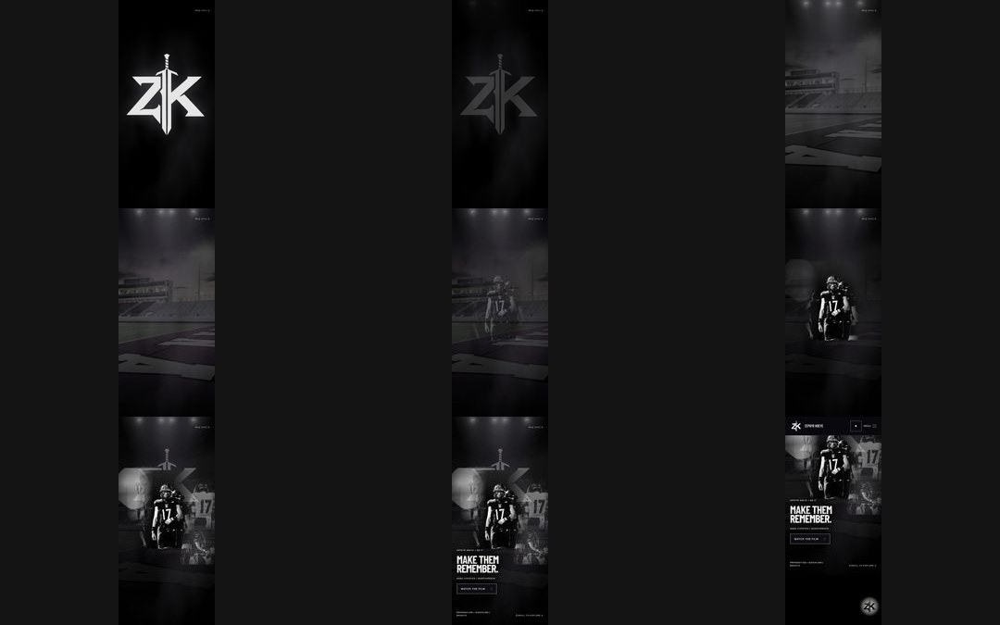
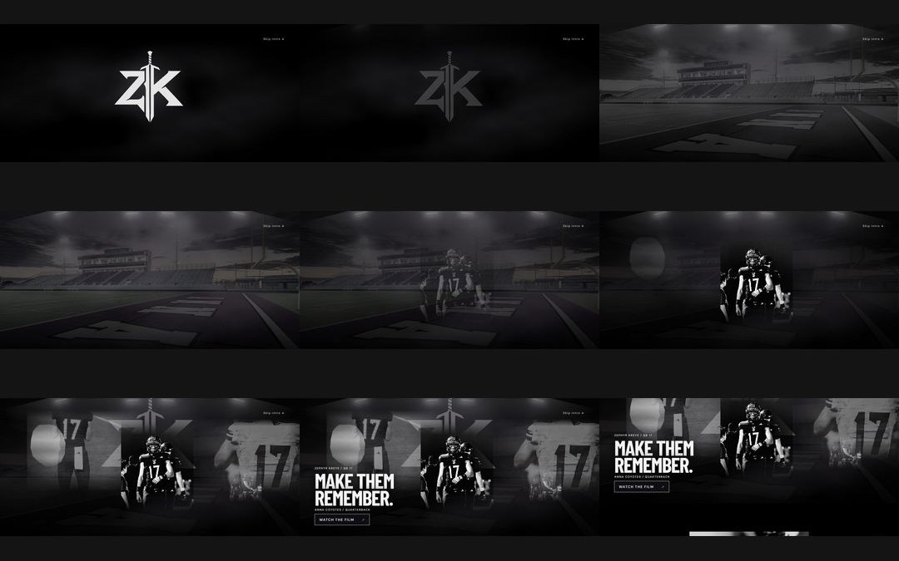

# Cinematic opening refinement QA

The approved homepage introduction now opens on the canonical ZK logo and drifting smoke, progressively ignites lights, reveals the owner-supplied empty Anna stadium in monochrome, introduces muted original color, brings Zephyr into the scene, accumulates the existing supporting photographs, and resolves to MAKE THEM REMEMBER. The existing homepage, separate pages, typography, navigation, film and other content remain unchanged.

## Source and delivery boundaries
Owner confirmed on 2026-11-02 that the supplied 1500x1001 PNG is a real photograph and authorized use. The exact original is preserved in brand/anna-stadium/owner-original.png with SHA-256 provenance. Four WebP derivatives avoid enlarging the source; mobile requests only the two 768px files (~78KB combined), desktop the two 1500px files (~346KB combined). Color is introduced by opacity crossfade, not a scroll-time full-screen filter. Existing athletes remain grayscale. Original athlete assets were not edited.

One existing ScrollTrigger still owns the intro, with 2.4 viewport heights desktop and 1.6 mobile. Measured captures: 2160px at1440x900;1350px at390x844;624px at844x390. The end composition, header release threshold and existing navigation destinations are retained. No dependencies added.

## Visual evidence
Screenshots for every major beat and contact sheets are in ../.agent/evidence/opening-refinement/screenshots/.

- Desktop1440x900: logo, ignition, monochrome/color stadium, silhouette, hero, montage, statement and release inspected.
- Emulated iPhone WebKit390x844: same nine states inspected, face/uniform/headline remain legible, stadium press box/end zone retained in portrait crop.
- Touch WebKit landscape844x390: same nine states inspected, composition stays inside the viewport.
- No page/console errors or horizontal document overflow captured in these journeys; exact observations in visual-checks.json.

## Verification and repairs
Build, TypeScript, lint and62unit tests pass. Focused cinematic tests verify initial/slow-loading branded paint with moving smoke, stage order, stadium decode and selected responsive requests, portrait accumulation, fast end/reverse scrolling, header completion, rotation, client routing, no-script and reduced-motion fallback. Full suite result recorded below after final verification.

Independent Astra source/runtime review caught duplicate desktop image preloads on mobile and paused smoke before hydration; both repaired and independently rechecked in Chromium and WebKit. Reduced motion removes pinning and smoke animation, while static content remains readable. Smoke pauses after leaving the intro or hiding the document. Coalesced image decode/load refreshes and GSAP/listener cleanup are retained.

The existing unit harness was not portable on Windows (extensionless command shims and Bash environment/CRLF handling). Test-only repairs preserve real retrieval metadata/hash validation and original workflow guard execution; no playoff product code changed. Browser test repairs, if present, preserve existing geometry/focus requirements while waiting for settled viewport size or accounting for native WebKit button focus behavior.

## Limits
Windows Chromium and WebKit browser emulation are local evidence. Physical iPhone/Safari smoothness, browser toolbar behavior, thermal/memory performance and real-device frame rates are not verified. Transform/opacity effects and smaller assets reduce avoidable work, but this is not a measured physical-device performance comparison. No production deployment or merge is part of this change.

## Final integrated result

Final serialized suite:173 passed,7 existing conditional skips,0 failures (full-e2e-accepted.log). Focus/resize harness repairs independently reviewed by the separate critic; isolated focus16/16 and cinema8/8 pass. Earlier failed/concurrent runs are retained as debugging evidence, not presented as final results. Final lint and typecheck exit0 without warnings; unit62/62. Product build passed after final product edits. No physical iPhone test or performance baseline comparison is claimed.

Independent Astra review accepted product commit ccaab62e193b570bd3ac52db9af848124b32540a with no remaining material findings; review.md contains the exact source blob identities and evidence. The delivery-only head uses Cloudflare's [CF-Pages-Skip] commit prefix to suppress automatic branch deployment, per https://developers.cloudflare.com/pages/configuration/git-integration/github-integration/. This does not skip or replace the recorded local tests.
