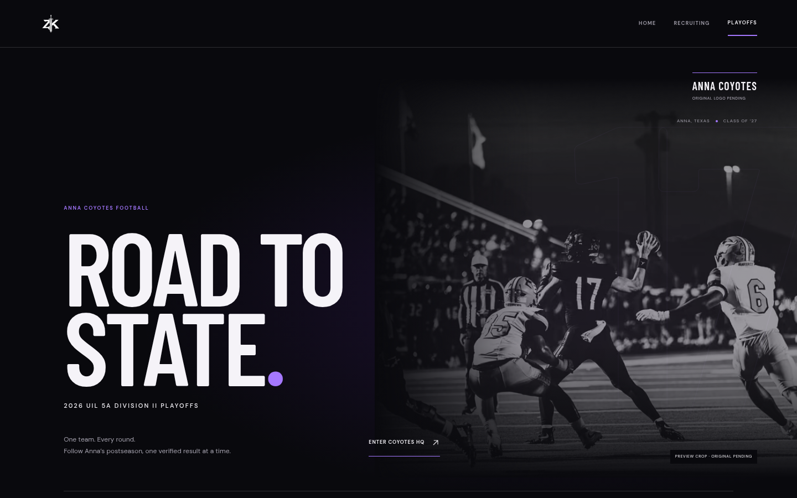

# Road to State — review and QA

Branch: `feature/road-to-state-2026`, based on PR #1 at `b8fa5de`. The Playoffs PR is stacked on `feature/recruiting-completion-audit`; PR #1 is not overwritten or merged. Current homepage changes are limited to the new Playoffs navigation destination. Existing Film Room, Recruiting Snapshot, Journey, arcade and media gates remain intact.

## What is implemented

Static `/playoffs/` with the existing ZK sword mark, black/charcoal/purple/ivory editorial style, on-field review photo and atmospheric 17. HQ handles pending/scheduled/live/final/postponed/canceled states; the road uses verified advancement only. Full four-region + state graph, native horizontal scroll controls, per-round selection, list alternative and shareable `#game=...`/`#round=...` Game Center. Copy failure exposes a selectable URL. Native modal Escape/focus/body-scroll cleanup and back navigation are supported. Current-season team alignment and official schedule/roster/staff links are included; unverified details stay pending.

Scoped GSAP entrance/parallax and section/bracket/round transitions reuse the existing stack. Optional motion loads after an initial frame, with shared lazy imports and disposal guards; static content and controls do not wait for it. Unrelated routes are not prefetched during the Playoffs arrival. matchMedia removes motion for reduced-motion users; nothing is pinned or scroll-jacked on this route. The bracket itself scrolls horizontally without overflowing the page. Matchup card accessible names include their visible contents; focus rings are inherited from ZK17.

Model integrity, source hierarchy, scheduled retrieval and controlled static updates are documented in [PLAYOFFS_DATA.md](PLAYOFFS_DATA.md). Build validates the entire graph and brand provenance. No real 2026 playoff teams or scores are published because the actual UIL-linked 2026 bracket inspected still has district-finish placeholders. Synthetic scores exist only in tests and a separate local `/tmp` fixture build.

## Actual validation

- `npm ci`: passed (existing ESLint support deprecation warning; no dependency added).
- `npm run typecheck`: passed.
- `npm run lint`: passed.
- `npm test`: **28 passed**, zero failures. Includes full graph/count/seed relationships, normalization, ties/incomplete/provisional scores, all statuses, explicit winners, official/secondary conflicts, stale/future verification, district/region identity, propagated winners, Anna wins/elimination, source-gated game-film links and the missing original-art public-release gate.
- `npm run build`: passed; static export includes `/playoffs/`; source journal has zero result observations.
- `npm run e2e -- --workers=3`: **64 passed, 8 intentional project-specific skips**, zero failures. Desktop Chromium, Pixel 7 Chromium emulation and reduced motion. Existing site's tests remain green. New tests cover primary navigation/active route, 63 cards via All regions, region/round/list filtering, game direct links/Escape/focus/back, native mobile rail keyboard scroll, no overflow, reduced motion, delayed-font layout stability, prevention of duplicate hero image downloads and axe scans of the page and modal.
- `npm run playoffs:retrieve`: four official sources retrieved successfully with MIME/signature checks and hashes. This is a retrieval test, not a claim that the GitHub schedule is already active.
- `npm run playoffs:validate`: 63 games, zero reviewed results, no inferred advancement.
- Isolated fixture build on localhost: synthetic Anna final renders score 28–21, explicit verified winner, completed road step and two correctly highlighted bracket positions (completed game + next-round Anna slot). HQ correctly advances to the next round with its opponent pending. Nothing from that fixture build was copied into the actual content artifact or deployed.

Raw test/build/fixture logs and final desktop/mobile console error arrays are under `artifacts/playoffs/`. Captured console/runtime error arrays are empty. The first browser pass caught label/name mismatches; those were fixed and the complete suite rerun successfully. Tests do not claim all possible browsers or real hardware have been validated.

## Visual evidence

Existing live preview baseline: `artifacts/playoffs/baseline/live-desktop.png` and `live-mobile.png`. New route screenshots and interaction WebMs: `artifacts/playoffs/after/`.

[Mobile hero](../artifacts/playoffs/after/mobile-hero.png) · [Mobile HQ](../artifacts/playoffs/after/mobile-anna-hq.png) · [Road](../artifacts/playoffs/after/desktop-anna-road.png) · [Regional bracket](../artifacts/playoffs/after/desktop-bracket.png) · [List](../artifacts/playoffs/after/mobile-list.png) · [Game Center](../artifacts/playoffs/after/mobile-game-center.png)

[Desktop interaction recording](../artifacts/playoffs/after/desktop-interaction.webm) · [Mobile recording](../artifacts/playoffs/after/mobile-interaction.webm)

## Acceptance and release limits

**Exact owner coyote logo and canonical approved mockup are missing.** Repository and attachment directories were searched and the owner was asked to supply both originals. No substitute coyote is rendered. The current styled implementation follows the written direction, not a claim to have matched an unseen mockup. Final visual acceptance and exact-logo acceptance remain blocked. The brand manifest/validator is ready for the original asset, hash, dimensions, alpha/aspect checks and owner approval; public release fails while it is absent.

No playoff qualifier or game result was available to publish; the complete graph remains useful with official district/finish/feeder labels. Coaching, date windows, opponents, scores and venues await specific 2026 evidence. Schedule/roster/staff destinations link to the official team source without asserting their data is verified here. Approved original photography/film and the existing public-release dependencies still apply.

Physical iOS/Android, native Safari and field INP were unavailable. Mobile emulation and a single-device lab report cannot guarantee field Core Web Vitals or future media performance. No public deploy, index enable, merge, authentication or database was introduced. The scheduled retrieval workflow will only run on schedule after normal review/merge places it on the default branch; it has no deployment or write permission.

Viewport inspection at 320, 390, 768 and 1440px: no page overflow, no pins, region controls at least 44px tall. Raw results: `artifacts/playoffs/viewport-checks.json`.

Game film relationships in `content/playoffs/game-films.json` require source-backed verified/published assignments and existing rights-approved local video assets. Eligible game links open the established Film Room; pending/unverified relationships render nothing. No actual assignment is configured.

The update CLI was also exercised in the isolated `/tmp` fixture directory: normalized team names resolved to stable IDs, a provisional game became an explicit final, and replay validation confirmed 63 games/two local test observations. The real artifact still contains zero observations. Global Last verified is monotonic; game timestamps stay separate.

## Performance measurements and remaining target gap

Lighthouse 13.6.0 / Chromium 154, mobile simulated defaults (150ms RTT, approximately 1.6 Mbps, 4× CPU slowdown), local static export. The initial run found CLS 0.191 caused by the decorative 17 changing width during font swap. Its geometry is now reserved: a forced 700ms font-delay browser check fell to 0.079 and passes in all three browser projects. Both before/after shift traces are retained.

Responsive hero preloading now requests one selected AVIF at high priority instead of both an unused 81KB WebP and the displayed 46KB AVIF. Browser regression tests assert one AVIF/no redundant WebP. Motion is lazy, the main photograph stays at its server-rendered geometry, and unrelated routes are not prefetched during arrival.

| Measurement | Result |
| --- | ---: |
| Final local check with gzip transfer compression | Lighthouse performance 91 |
| LCP, compressed local check | 3.0 s |
| CLS, compressed local check | 0.079 |
| TBT, compressed local check | 150 ms |
| Speed Index, compressed local check | 1.2 s |

**The earlier 2.5s LCP target is not met in this simulated mobile check.** Further mobile LCP validation/tuning remains before production signoff. TBT is not INP; field INP and physical-device smoothness are unmeasured. This is not a claim of production Core Web Vitals compliance.

Bare local HTTP checks (without transfer compression) were slower, with exploratory LCP around 4.7–5.4s. These reports are retained rather than suppressed. Final compressed and exploratory uncompressed reports have different delivery settings and are not presented as a controlled code-only improvement. The optional `node scripts/serve-static.mjs --port 3103 --compress` mode provides gzip for local CDN-like delivery checks; it does not deploy a site or establish actual Cloudflare behavior. Cloudflare HTTP/2/Brotli/cache settings must be verified on an authorized review/release deployment. The compression check confirms identical HTML after decompression, identity fallback and respect for gzip q=0; the approximately 65KB document transfers in approximately 9KB. Default server behavior remains unchanged.

Reproduce final visual recordings with `PLAYWRIGHT_CHROMIUM_EXECUTABLE_PATH=/usr/bin/chromium node scripts/capture-playoff-evidence.mjs` while the export is served locally. Playwright FFmpeg is required; `EVIDENCE_URL` can select another authorized local/review origin. The script records native bracket scrolling, region selection, list view and the Game Center.
