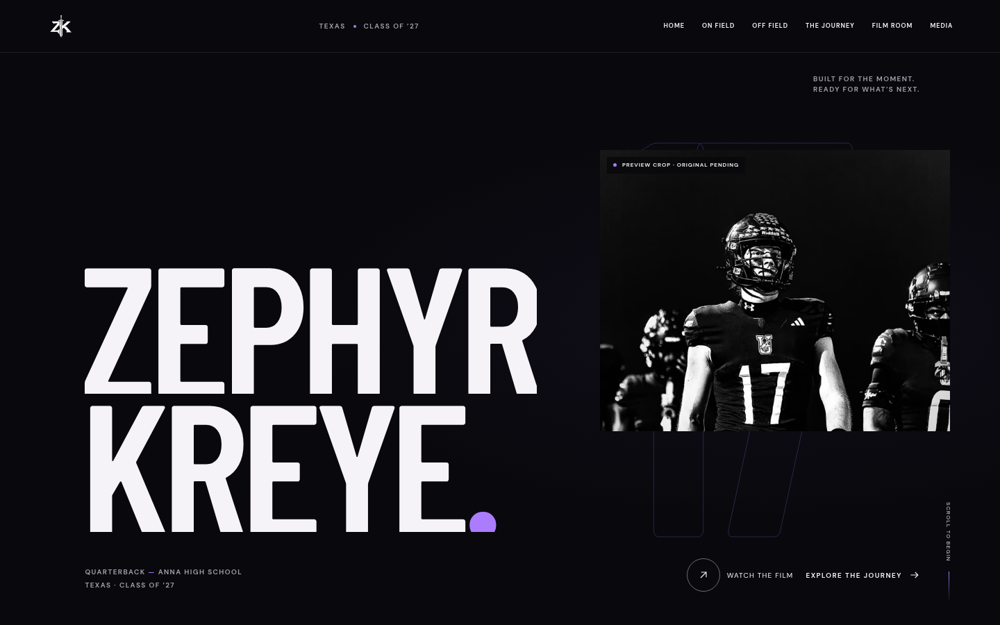
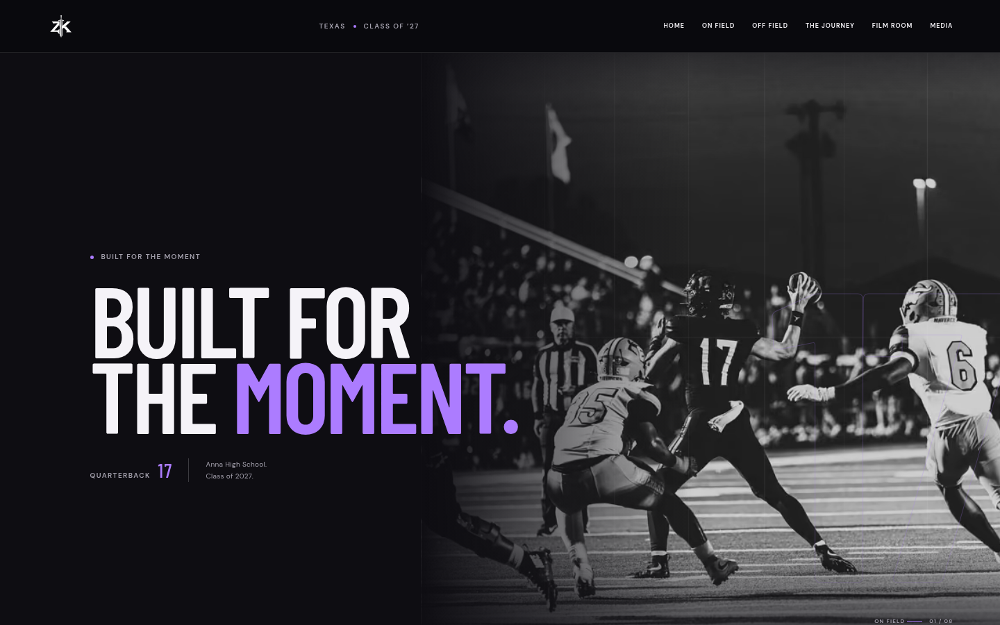
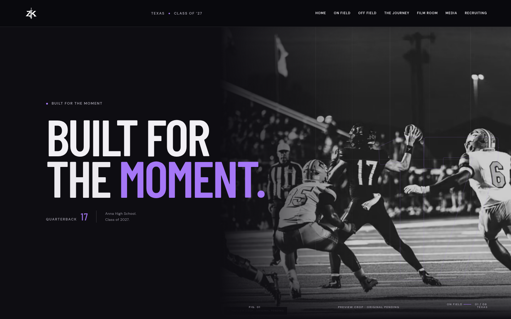
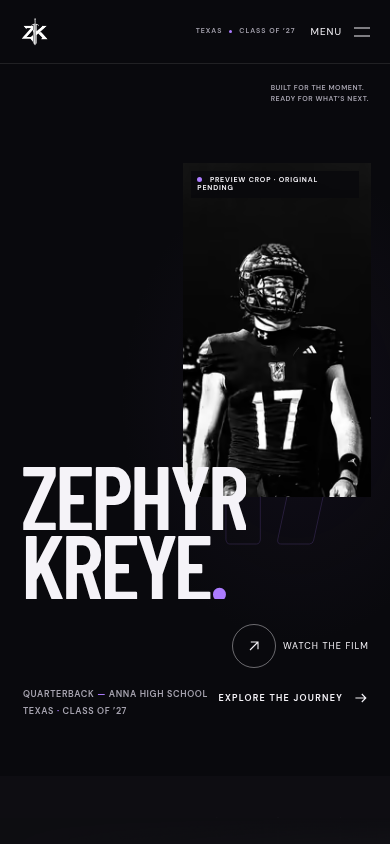
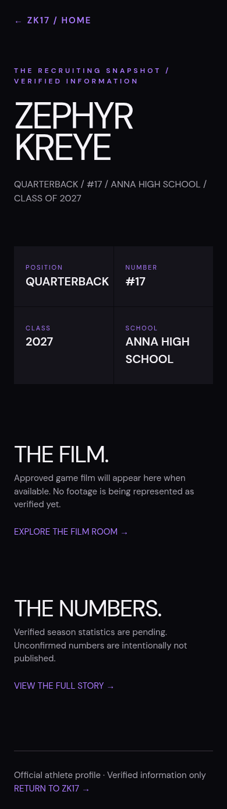
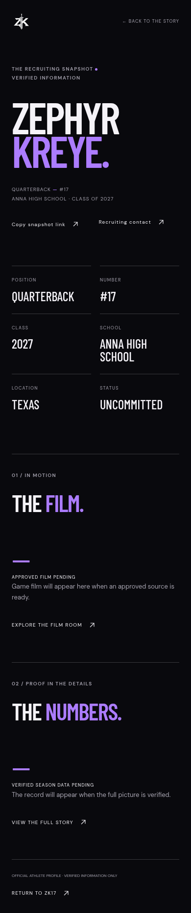

# Scroll polish review evidence — 2026-11-01

## Scope and design preservation
Continues PR #1's existing branch from `185e0eb`. The first PR already contained a basic recruiting route despite its documentation-only description. No completed sections were replaced: original sword logo, black/ivory/purple palette, typography, hero composition, eight chapters, arcade picks and footer/contact remain. No reference assets are shipped, no scroll dependency added, and no public deploy or merge command was run.

## Choreography
- Hero: short overlapping sword-mark/name/photo/info/cue arrival; readable at first paint. Photo, title and number move at separate native-scroll rates. No hero pin/loader.
- On Field: one timeline owns photo scale, independent 17, line reveal and detail arrival. Desktop ≥900px and height ≥650px uses a 65%-viewport pin, then releases. Mobile/short screens use ordinary document flow.
- Film Room: line-by-line title, scale/depth frame entrance, staged captions and gallery reveals; restrained hover/focus play control. On-demand dialog has keyboard closing/focus restoration and native controls without autoplay. `/#film=<encoded asset ID>` opens approved local video; unknown/missing IDs show the honest empty state. Existing season selection remains.
- Off Field: approved dark-to-light transition, opposing personal-photo drift, lighter type movement. Existing desktop arcade rail is retained. No transforms target game controls; mobile and reduced motion stack naturally.
- Journey: extending line, aligned origin marker, individually revealed verified milestone cards and open-ended final marker. Responsive grid accepts future approved records without overflowing.
- Numbers: exact verified values with progressive row motion, including after season changes. No counter from invented values. Empty state remains polished.
- Next Chapter/footer: restrained graphic depth and title/monogram reveals. Commitment model and announcement gates unchanged.

## Engineering
`use-story-motion.ts` replaces the existing animation effect, scopes selectors to the main component and owns matchMedia/cleanup. Font readiness, image loads and data container resizes coalesce measurement refreshes; refresh preserves active controls when pin measurement moves DOM. No React state updates during scroll. Native scrolling and anchor history stay authoritative. Reduced motion dynamically reverts motion and pins. Content renders readable without animation.

Recruiting uses existing CSS variables/editorial hierarchy; verified facts, film/stat empty states, home/film/story/contact links and copy link with selectable-address fallback. No measurements, offers, academic facts or representative details invented. Media rights/publish filters and release tests remain intact.

## Browser evidence
`artifacts/scroll-polish/before/` and `after/` contain 1440×900 desktop and 390×844 mobile screenshots, full recruiting captures and native-wheel WebM recordings. Baseline was rebuilt from the untouched PR head (`185e0eb`) at local port 3101; final served at 3100. Reproduce screenshots/recordings with `node scripts/capture-scroll-evidence.mjs after` (requires Chromium/Playwright FFmpeg); set `EVIDENCE_URL` for baseline.

`browser-qa.json` includes Chromium DevTools Performance-domain metrics and sampled scene transforms: desktop top stays 0 mid-pin, scale changes 1.025→1.0816→1.14 and scene bottom becomes −135 after release. Mobile/reduced-motion: zero pins, zero overflow; reduced photo transform `none`. Console/page error arrays empty in desktop/mobile recordings.

Reference research, screenshots and recording: [live study](SCROLL_REFERENCE_2026-11-01.md). Headless WebGL did not fully render the reference hero; this limitation is recorded rather than inferred away.

## Automated validation
- `npm ci`: completed successfully.
- `npm run typecheck`, `npm run lint`, `npm test`, `npm run build`: completed successfully; 14 content/contact/release unit tests.
- Browser suite: final result below after the last accessibility corrections. Projects cover desktop Chromium, Pixel 7 Chromium emulation, and reduced motion. Intentional skips are viewport/project-specific tests.
- Axe checks cover homepage and recruiting; native dialog, focus, navigation, copy fallback, empty media, pin release, resize overflow, reduced motion and existing arcade are covered.

Physical iOS/Android browsers and Safari were unavailable. Browser emulation does not establish physical-device smoothness, field INP, bfcache across every browser, or performance after future originals arrive. Native video wiring is implemented; real approved athlete footage remains unavailable and cannot be certified by an empty-state test. No fabricated film was published.

## Release dependencies
Original rights-approved photos/film, verified season stats and highlights, approved public contact/social links and owner public-release approval remain pending. Preview photographs remain explicitly labelled and blocked from public release by existing gates. No unannounced college commitment enters the data or bundle. This is a reviewable software change, not a production-release signoff.

Final suite after focus/stacking corrections: **46 passed, 8 intentionally skipped, zero failures** in 25.9s. See `artifacts/scroll-polish/e2e-results.txt` and `build-results.txt`.

## Comparable mobile lab measurements
Lighthouse 13.6.0, local static exports, same Chromium 154, mobile simulated throttling (150ms RTT / 1,638.4 Kbps / 4× CPU), three alternating baseline/final runs with other browser jobs stopped. Baseline rebuilt from `185e0eb`; paired final results before the final small focus/vignette correction. A separate `final-commit.json` recheck records the last code commit. Raw reports are under `artifacts/scroll-polish/performance/`.

| Metric | Baseline median | Changed site median |
| --- | ---: | ---: |
| LCP | 1.355 s | 1.356 s |
| CLS | 0.0643 | 0.0643 |
| Total blocking time | 54 ms | 102.5 ms |
| Lighthouse performance score | 99 | 98 |

LCP ranges: baseline 1.206–1.363 s; changed 1.354–1.356 s. These controlled samples meet the requested lab LCP/CLS targets. TBT rose by 48.5 ms; it is **not INP**, which requires real interactions/field measurement. No field INP or universal CWV claim is made.

Exploratory measurements were variable: the initial baseline reported 1.4s LCP/0.064 CLS/170ms TBT; one later final run reported 5.8s LCP/0.064 CLS/110ms TBT, and another overlapped browser tests (1.6s/0.066/380ms). The retained top-level baseline/final raw files document initial exploratory measurements; controlled paired reports carry the comparison. This environment cannot establish a physical-mobile performance guarantee or remove run-to-run uncertainty. Recheck with rights-approved originals and representative hardware before public release.

## Screenshot comparison

| Desktop baseline | Desktop after |
| --- | --- |
|  |  |
|  |  |

| Mobile baseline | Mobile after |
| --- | --- |
|  |  |
|  |  |

Recordings: [desktop before](../artifacts/scroll-polish/before/desktop-scroll.webm), [desktop after](../artifacts/scroll-polish/after/desktop-scroll.webm), [mobile before](../artifacts/scroll-polish/before/mobile-scroll.webm), [mobile after](../artifacts/scroll-polish/after/mobile-scroll.webm), [reference interaction](../artifacts/scroll-polish/reference/desktop-scroll.webm).

Last code commit (`1b2b090`) independent recheck: **LCP 1.356 s, CLS 0.0643, TBT 115 ms, Lighthouse performance 98**. This remains a single lab recheck; paired medians above describe the three-run comparison.
